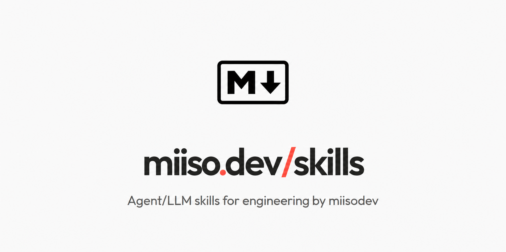

[](https://mcprush.com/miisodev)
[](https://skills.sh/miisodev/skills)
[](https://github.com/miisodev/skills/releases)
[](LICENSE)

**Sponsorship** — if these skills save you time, you can support further work:

- [GitHub Sponsors](https://github.com/sponsors/miisodev)
- [PayPal](https://paypal.me/miisodev)

Agent/LLM skills for engineering by miisodev

## What it is

Two agent skills as plain Markdown on the open [Agent Skills](https://agentskills.io/) specification, plus one standard-library Python script. They work in Claude Code, Codex, Cursor, Gemini CLI, GitHub Copilot, OpenCode, Windsurf and [every other agent the `skills` CLI supports](https://github.com/vercel-labs/skills#supported-agents) — independent of stack, vendor and region. No account, no telemetry, no remote code.

[blueprint](https://mcprush.com/miisodev/blueprint), [production](https://mcprush.com/miisodev/production) and [BrainLLM](https://mcprush.com/miisodev/brainllm-mcp) are also together on the [MCPRush publisher page](https://mcprush.com/miisodev).

## What it's for

**When to use which:** starting or re-planning something → `blueprint`. About to ship, or judging what stands in the way → `production`. Both, in order: `blueprint` sets the intent, `production` checks the shipped product against it.

| Skill | What it does | Try |
|---|---|---|
| [**blueprint**](skills/blueprint/SKILL.md) | Establishes a project's foundation together with you in seven documents: vision, market, business, product, brand, stack and plan. It covers the core idea, market research and strategy, the business model and unit economics, targets, requirements, brand, stack, resources and the grand plan. Each document is discussed, researched and computed, drafted, critiqued and approved by you, with a workbook so the work resumes in any session. It sets intent and leaves design and implementation to the model that builds. A brief mode gives internal tools, libraries and migrations one-page intent instead of the full cycle. | "Let's blueprint this idea" · "Continue the blueprint" · "Our pricing changed, update the blueprint" · "Turn our PRDs into a blueprint" |
| [**production**](skills/production/SKILL.md) | An autonomous readiness audit across 39 parts with 753 evidence-backed checks. It inventories surfaces, assesses applicable checks and returns a structured JSON payload and report ranking parts and surfaces by risk. Decisions are GO, GO WITH CONDITIONS, HOLD or NO-GO per surface and overall; the audit is fail-closed — every expected check needs a recorded result, and a missing check holds the decision. A scoped run reports its decision for the audited scope only. | "Is this ready to launch?" · "Run a production readiness audit" · "Give me a go/no-go for the v2 release" · "Are these screens actually finished?" · "Audit this MCP server before release" |

They work well together: the production audit finds the blueprint wherever the project keeps it, and its `product.md` becomes the requirements standard the audit checks against.

### Production coverage

The shared checks cover functional behavior, UX, accessibility, security, identity, data, privacy, reliability, operations, AI, billing and launch. Version 1.1.0 adds dedicated coverage for:

| Boundary | What the audit examines |
|---|---|
| MCP servers, clients and hosts | Protocol versions, tool/resource contracts, permissions, transports and supported extensions |
| Agents and automation | Delegated authority, approvals, budgets, cancellation and recovery without duplicated actions |
| Self-hosted deployments | Installation, configuration, upgrades, recovery and disconnected operation |
| Offline synchronization | Durable local work, conflicts, reconnects and revoked access |
| Real-time and event systems | Delivery guarantees, stream access, backpressure and replay |
| Device and embedded software | Identity, pairing, authenticated updates and failure recovery |
| Software supply chains | Build provenance, artifact verification and compromised-release response |

Apply these to the capabilities a product actually has. A static site does not need billing; a local MCP server does not need a cloud deployment. Existing mobile, desktop, extension and package checks remain, with added data-pipeline, model-lifecycle, SDK/CLI and non-web accessibility checks. See the [product routing guide](skills/production/references/product-routing.md).

### Requirements

- `blueprint`: none beyond an agent that can read and write files. Web access improves market research.
- `production`: Python 3.8+ for the scoring script (standard library only). Without it, the agent applies the documented decision rules by hand.

## Quick setup

Install both skills in any agent:

```bash
npx skills add miisodev/skills
```

Install a single skill:

```bash
npx skills add miisodev/skills --skill blueprint
npx skills add miisodev/skills --skill production
```

Install globally for a specific agent without prompts:

```bash
npx skills add miisodev/skills --skill '*' -g -a claude-code -y
```

Update later with `npx skills update`.

### Claude Code plugin marketplace

```
/plugin marketplace add miisodev/skills
/plugin install miisodev-skills@miisodev-skills
```

### ChatGPT and Codex

Both work with the skills today. Codex reads the same skills folders (`~/.codex/skills/`), and ChatGPT can run any skill's instructions directly. The packaged plugin is in review for OpenAI's plugin directory; until it lists, the CLI is the fastest route.

### Manual install

Copy a folder from [`skills/`](skills) into your agent's skills directory — for example `.claude/skills/`, `.agents/skills/` or `~/.codex/skills/`.

## Disclaimer

The `production` skill's legal, privacy, tax and accessibility-law material is a starting map for engineering audits, not legal advice. Regulations and thresholds change. Confirm them with the regulator or counsel before relying on them. The audit is an engineering assessment, not a regulatory, functional-safety or platform certification. Its [source register](skills/production/references/standards-sources.md) records the expanded coverage baseline and how to check applicability/currentness. Review any skill before installing it.

## Access and support

**Access** — the skills reach you through every one of these:

- [`npx skills add`](https://github.com/vercel-labs/skills) and the [MCPRush publisher page](https://mcprush.com/miisodev)
- The [skills.sh listing](https://skills.sh/miisodev/skills)
- The Claude Code plugin marketplace, and [Anthropic's plugin directory](https://claude.com/plugins) (submission in review)
- The OpenAI plugin directory for ChatGPT and Codex (submission in review)
- This repository, and [miiso.dev/skills](https://miiso.dev/skills) — the skills' homepage

**Support** — issues are welcome for suggestions, bugs and feedback. The author reads them and acts in his own design. Pull requests are closed automatically and are not accepted. The skills are MIT licensed: fork the repository and do whatever you like with your copy. Security reports are welcome privately (see [SECURITY.md](SECURITY.md)).

## License

[MIT](LICENSE) © Kevin Miiso Novo
